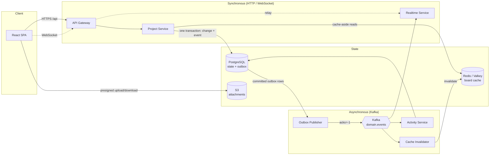

# Distributed Project Management Platform

A collaborative project-management application, built as TypeScript services around an
event-driven core. Every change is committed to PostgreSQL together with a domain event. A
publisher delivers those events to Kafka, and independent consumers keep an activity feed, a shared
board cache and live browser updates in step with the database. The system runs locally with
Docker Compose and on AWS (ECS Fargate, RDS, MSK, ElastiCache, S3), provisioned with Terraform.

## Features

- **Workspaces** with owner, admin and member roles; admins create projects.
- **Boards:** each project has a board with columns and ordered tasks. Tasks can be moved by drag
  and drop or from the keyboard, and filtered by text or assignee.
- **Tasks** with descriptions, assignees and comments. Concurrent edits are detected with versions:
  a stale save is rejected with 409 and the client shows the latest state.
- **Activity feed** per project, built asynchronously from domain events.
- **Realtime updates:** other users' changes appear without a reload.
- **Attachments:** files are uploaded to and downloaded from S3 directly by the browser.

## Architecture



- **Write path:** the browser talks only to the API Gateway, which forwards REST calls to the
  Project Service and relays WebSockets to the Realtime Service. The Project Service is the only
  writer of domain state. It never calls Kafka: a request succeeds when its transaction commits.
- **Asynchronous path:** the Outbox Publisher sends committed events to Kafka, keyed by project so
  each project's events stay in order. Each consumer has its own consumer group, so a stopped
  consumer delays only its own work.
- **Attachments:** the API authorizes the upload, signs a short-lived URL and records metadata. The
  bytes never pass through the API.

More detail is in [docs/architecture.md](docs/architecture.md),
[docs/consistency-and-delivery.md](docs/consistency-and-delivery.md),
[docs/configuration.md](docs/configuration.md) (every environment variable),
[docs/performance.md](docs/performance.md) (load-test method and measured results) and the decision records in
[docs/adr/](docs/adr/).

## Technology Stack

| Area           | Technology                                                                      |
| -------------- | ------------------------------------------------------------------------------- |
| Frontend       | React 19, Vite, React Router, TanStack Query                                    |
| Backend        | Node.js 24, TypeScript, Fastify, Zod, Pino                                      |
| Database       | PostgreSQL 17, Drizzle ORM, SQL migrations                                      |
| Messaging      | Apache Kafka (KafkaJS); Amazon MSK on AWS                                       |
| Cache          | Valkey (Redis-compatible), ioredis; Amazon ElastiCache on AWS                   |
| Realtime       | WebSockets (`ws`), relayed through the gateway                                  |
| Object storage | Amazon S3 with presigned POST/GET; LocalStack locally                           |
| Observability  | Prometheus, Grafana (provisioned from the repository), correlation IDs          |
| Infrastructure | Docker Compose, Terraform (ECS Fargate, RDS, MSK, ElastiCache, ALB, CloudFront) |
| Testing        | Vitest, Testcontainers, Playwright, k6                                          |
| CI/CD          | GitHub Actions (OIDC to AWS, no stored keys), Turborepo                         |

## Prerequisites

- Node.js 22.12 or later (`.nvmrc` pins 24) and npm 10 or later
- Docker with Compose v2, for the local stack and the integration tests

## Local Development

```bash
cp .env.example .env                   # local-only defaults; every variable is documented there
cp apps/web/.env.example apps/web/.env
npm install
docker compose up --build              # all infrastructure and services
```

Compose starts PostgreSQL, Kafka, Valkey, LocalStack (S3), Prometheus and Grafana, runs the
database migrations (`migrate`) and creates the Kafka topics (`kafka-init`) and the S3 bucket
(`s3-init`) before the services that need them. Services validate their configuration at startup
and exit with the names of any invalid variables.

| URL                   | What                                                             |
| --------------------- | ---------------------------------------------------------------- |
| http://localhost:8080 | Web app. Sign in with any email (development login, local only). |
| http://localhost:3000 | API Gateway (`/api/...`, `/health`, `/ready`)                    |
| http://localhost:3300 | Grafana (anonymous read-only)                                    |
| http://localhost:9090 | Prometheus                                                       |

`node scripts/smoke.mjs` runs an end-to-end check against the running stack.
`docker compose down -v` stops it and deletes the data volumes.

To work on the request path without the service containers, start only the database and run the
services from source (Kafka is not needed to serve requests; events wait in the outbox):

```bash
docker compose up -d postgres migrate
npm run build
npm run dev -w @dpp/project-service   # :3001, reads ../../.env
npm run dev -w @dpp/api-gateway       # :3000
npm run dev -w @dpp/web               # :5173
```

To apply migrations to another database: `npm run build -w @dpp/database`, then
`npm run db:migrate -w @dpp/database` (uses `DATABASE_URL`).

## Testing

```bash
npm run check              # format, lint, typecheck, unit tests and build (no Docker needed)
npm run test:integration   # real PostgreSQL, Kafka, Valkey and LocalStack via Testcontainers
npm run test:e2e           # Playwright against the running Compose stack
                           # (first time: npx playwright install chromium)
npm run test:stack         # tests that drive the Compose stack, e.g. a Kafka outage
```

- **Unit tests** cover domain rules, contracts, configuration and the React app.
- **Integration tests** run each service and the cross-service chains (gateway → service →
  PostgreSQL → outbox → Kafka → consumers) against real infrastructure, including database and
  broker outages, crashes between steps, concurrent duplicates and poison messages.
- **Architecture tests** (`tests/architecture/`) enforce boundaries, for example that nothing on
  the request path depends on Kafka.
- **Deliberate breaks** (`scripts/mutations/`) apply a one-line defect to a critical guard and
  require the named tests to fail. They run in GitHub Actions through `mutations.yml`, for one
  group (`outbox`, `consumers`, `activity`, `cache`, `realtime`, `attachments`, `api`) or all.

In GitHub Actions, `ci.yml` runs static checks, `npm audit`, gitleaks, unit tests, image checks
(hadolint, non-root, Trivy) and the integration suites (sharded) on every push to `main` and on pull requests. `e2e.yml` builds the
Compose stack and runs Playwright nightly and on demand. See [docs/ci.md](docs/ci.md).

## AWS Deployment

`infrastructure/terraform` defines a development environment: ECS Fargate services behind an ALB
and CloudFront, RDS PostgreSQL, MSK, ElastiCache and S3. GitHub Actions builds the images and
deploys through OIDC; the deploy role trusts only this repository's `main` branch, and the
repository holds no AWS credentials. Deploys are manual:

```bash
npm run aws:rebuild   # create the environment, build and deploy main, verify (about 45 min)
npm run aws:deploy    # build and roll out the current main commit, migrate, smoke-test
npm run aws:status    # what is running and which commit is deployed
npm run aws:destroy   # tear everything down (asks for confirmation)
```

The environment bills while it exists. Setup, operations and a component-by-component mapping
from the local stack to AWS are in [docs/aws-development.md](docs/aws-development.md).

## Project Structure

```text
apps/
  web/                 React SPA
  api-gateway/         routing, CORS, rate limiting, timeouts, WebSocket relay
  project-service/     the only writer of domain state (workspaces, projects, tasks, attachments)
  outbox-publisher/    outbox → Kafka
  activity-service/    Kafka → activity feed
  cache-invalidator/   Kafka → board cache invalidation
  realtime-service/    Kafka → WebSocket notifications
  kafka-tools/         topic, DLQ inspection and replay CLI
packages/              shared code: auth, cache, config, contracts (events and HTTP), database
                       (schema, migrations, outbox, consumer idempotency), kafka, observability,
                       runtime, storage, test-utils
infrastructure/        docker/ (Dockerfiles), terraform/ (AWS), observability/ (Prometheus, Grafana)
scripts/               aws/ (deploy and operations), mutations/ (deliberate breaks), load/, outbox/
tests/                 cross-service integration, architecture, e2e (Playwright), stack, load (k6)
docs/                  architecture, consistency model, configuration, AWS and CI notes, ADRs
```

### Following a change through the system

| Step                                   | Where                                                                                                                                                    |
| -------------------------------------- | -------------------------------------------------------------------------------------------------------------------------------------------------------- |
| HTTP route and validation              | `apps/project-service/src/modules/tasks/routes.ts`                                                                                                       |
| Transaction, authorization, outbox row | `apps/project-service/src/modules/tasks/service.ts` (`create`), `insertOutboxEvent` in `packages/database/src/outbox.ts`                                 |
| Retry-safe creates (`Idempotency-Key`) | `apps/project-service/src/http/idempotency.ts`                                                                                                           |
| Claiming and publishing outbox rows    | `claimOutboxBatch` in `packages/database/src/outbox.ts`, `apps/outbox-publisher/src/publisher.ts`                                                        |
| Kafka consumption, retries and DLQ     | `packages/kafka/src/consumer.ts`                                                                                                                         |
| Consumer idempotency                   | `processEventOnce` in `packages/database/src/idempotency.ts`                                                                                             |
| Board cache and invalidation           | `packages/cache/src/shared-cache.ts`, `apps/cache-invalidator/src/worker.ts`, `getBoardCached` in `apps/project-service/src/modules/projects/service.ts` |
| WebSocket delivery                     | `apps/realtime-service/src/app.ts` (auth, subscriptions), `apps/realtime-service/src/hub.ts`                                                             |
| Browser reconciliation                 | `apps/web/src/lib/realtime/connection.ts`, `apps/web/src/lib/realtime/useProjectRealtime.ts`                                                             |
| Attachment upload and finalization     | `apps/project-service/src/modules/attachments/service.ts`, `packages/storage/src/object-storage.ts`                                                      |
| Gateway proxying and failure mapping   | `apps/api-gateway/src/proxy.ts`, `apps/api-gateway/src/app.ts`                                                                                           |

## Design Considerations

- **Transactional outbox.** A change and the event describing it are written in one PostgreSQL
  transaction, so an event can never disagree with committed state, and writes succeed while
  Kafka is down. The publisher marks an event published only after Kafka acknowledges it.
- **At-least-once delivery.** A crash between the acknowledgement and the marker resends the same
  event (same `eventId`), and consumers can be redelivered a message after a crash or rebalance.
  Nothing claims exactly-once.
- **Idempotency.** Consumers record each processed `eventId` in the same transaction as their side
  effect, so duplicates have no effect. On the HTTP side, creates accept an `Idempotency-Key`;
  updates use `expectedVersion`. When the outcome of a write is unknown (a timeout or a dropped
  connection after the request was sent), the API answers 504 `OUTCOME_UNKNOWN` rather than
  claiming it failed.
- **Caching.** Redis holds a disposable copy of each board. Authorization runs before the cache is
  read, Redis failures fall back to PostgreSQL, invalidation is driven by Kafka events, and a
  generation counter stops a slow reader from writing back a stale board.
- **Realtime reconciliation.** WebSocket messages are notifications, not state. The browser
  refetches from the API when notified and after every (re)connect, so a missed message leaves it
  briefly stale, never wrong.

The reasoning behind each choice is in [docs/adr/](docs/adr/).

## Limitations

- **AWS verification is recent but not exhaustive.** On 2026-10-18/19 the current code passed
  `aws:smoke`, `aws:test` (correlation across every hop, Kafka probe, network boundaries, CRUD
  with the publisher stopped), the MSK broker-reboot drill with `min.insync.replicas=2`, load
  tests and `aws:invariants` ([docs/performance.md](docs/performance.md)). The RDS reboot and
  task-stop drills were last run on earlier code.
- **The dev database is sized for this load, not more.** `db.t4g.micro` (1 GB) swapped under
  sustained load and stalled every statement; `db.t4g.small` removed the stalls (0 errors, no swap
  in the same test). Larger load needs a larger instance; see
  [docs/performance.md](docs/performance.md).
- **Kafka favours durability over availability.** MSK runs `min.insync.replicas=2` with two
  brokers, so losing a broker pauses publication (events wait in the outbox) rather than risking
  acknowledged events.
- **Rate limits are per gateway task and per token.** Counters are in memory, so N gateway tasks
  allow up to N × the limit. The gateway does not verify tokens, so a client that invents a new
  token for each request is not limited (the Project Service still rejects those requests).
- **Realtime access is checked at subscribe time.** A user removed from a project keeps receiving
  its notifications (IDs only) until the connection closes; refetches are authorized.
- **Development-sized AWS environment:** one task per service, single-AZ RDS on a burstable
  instance class, and a passwordless development login that is refused unless
  `DEPLOYMENT_ENVIRONMENT` is a non-production value.

See [docs/consistency-and-delivery.md](docs/consistency-and-delivery.md) for the precise
guarantees and their limits.
