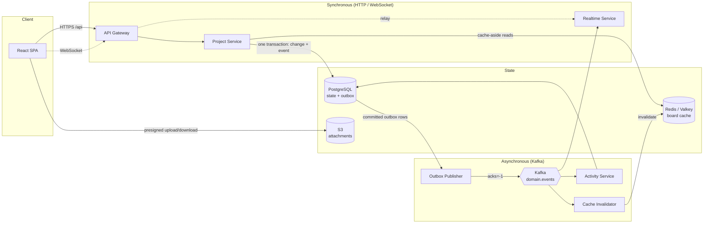

# Distributed Project Management Platform

A collaborative project-management application (workspaces, projects, task boards, comments,
assignees and file attachments) built as a set of TypeScript services around an event-driven
core. Changes are committed to PostgreSQL and published to Kafka through a transactional outbox.
Independent consumers build an activity feed, keep a shared board cache fresh and push realtime
updates to browsers over WebSockets. The system runs locally with Docker Compose and on AWS (ECS
Fargate, RDS, MSK, ElastiCache, S3, CloudFront), provisioned with Terraform.

## Architecture



- **Synchronous path:** the browser talks only to the API Gateway. The gateway forwards REST
  calls to the Project Service and relays WebSockets to the Realtime Service. The Project
  Service is the only writer of domain state.
- **Asynchronous path:** the Outbox Publisher delivers committed events to Kafka, keyed by
  project for per-project ordering. Each consumer has its own consumer group and works
  independently, so a stopped consumer delays only its own projection.
- **Attachments:** bytes go directly between the browser and S3 with presigned URLs; the API
  only authorizes and records metadata.

More detail: [docs/architecture.md](docs/architecture.md),
[docs/consistency-and-delivery.md](docs/consistency-and-delivery.md) and the decision records
in [docs/adr/](docs/adr/).

## Tech stack

| Area           | Technology                                                                                |
| -------------- | ----------------------------------------------------------------------------------------- |
| Frontend       | React 19, Vite, React Router, TanStack Query                                              |
| Backend        | Node.js 24, TypeScript, Fastify, Zod (validated config and contracts), Pino               |
| Database       | PostgreSQL 17, Drizzle ORM, SQL migrations                                                |
| Messaging      | Apache Kafka (KafkaJS); Amazon MSK on AWS                                                 |
| Caching        | Valkey (Redis-compatible), ioredis; Amazon ElastiCache on AWS                             |
| Realtime       | WebSockets (`ws`), relayed through the gateway                                            |
| Object storage | Amazon S3 (presigned POST/GET); LocalStack locally                                        |
| Observability  | Prometheus metrics, Grafana dashboards (provisioned from the repository), correlation IDs |
| Infrastructure | Docker, Docker Compose, Terraform (ECS Fargate, RDS, MSK, ElastiCache, ALB, CloudFront)   |
| Testing        | Vitest, Testcontainers, Playwright, k6                                                    |
| CI/CD          | GitHub Actions (OIDC to AWS, no long-lived keys), Turborepo                               |

## Repository layout

```text
apps/            web, api-gateway, project-service, outbox-publisher, activity-service,
                 cache-invalidator, realtime-service, kafka-tools
packages/        auth, cache, config, contracts, database, kafka, observability, runtime,
                 storage, test-utils
infrastructure/  docker/ (Dockerfiles), terraform/ (AWS), observability/ (Prometheus, Grafana)
scripts/         aws/ (deploy and operations), load/ (load-test runner), kafka/, outbox/,
                 mutations/ (deliberate-break checks), ci/
tests/           integration/, architecture/, e2e/ (Playwright), stack/, load/ (k6)
docs/            architecture, consistency model, AWS and CI notes, ADRs
```

## Getting started

### Prerequisites

- Node.js ≥ 22.12 (`.nvmrc` pins 24) and npm ≥ 10
- Docker with Compose v2

### 1. Configure the environment

```bash
cp .env.example .env
cp apps/web/.env.example apps/web/.env
```

The defaults are for local development only. `.env.example` documents every variable;
services validate their configuration at startup and exit with the names of any invalid
variables.

### 2. Install dependencies

```bash
npm install
```

### 3. Start the stack

```bash
docker compose up --build
```

This builds the service images and starts PostgreSQL, Kafka, Valkey, LocalStack (S3),
Prometheus, Grafana and all services. The `migrate` service applies the database migrations
and `kafka-init` creates the topics before the services that need them start.

To apply migrations yourself (for example, when running services outside Docker):

```bash
npm run build -w @dpp/database
npm run db:migrate -w @dpp/database   # uses DATABASE_URL from .env
```

### 4. Open the application

| URL                   | What                                                             |
| --------------------- | ---------------------------------------------------------------- |
| http://localhost:8080 | Web app. Sign in with any email (development login, local only). |
| http://localhost:3000 | API Gateway (`/api/...`, `/health`, `/ready`)                    |
| http://localhost:3300 | Grafana (anonymous read-only)                                    |
| http://localhost:9090 | Prometheus                                                       |

`node scripts/smoke.mjs` runs an end-to-end check against the running stack.

### Fast local development (without the service containers)

```bash
docker compose up -d postgres migrate
npm run build
npm run dev -w @dpp/project-service   # :3001, reads ../../.env
npm run dev -w @dpp/api-gateway       # :3000
npm run dev -w @dpp/web               # :5173, calls VITE_API_BASE_URL
```

### Stop

```bash
docker compose down      # stop
docker compose down -v   # stop and delete the data volumes
```

## Testing

```bash
npm run test               # unit tests (no external dependencies)
npm run test:integration   # integration tests against real PostgreSQL, Kafka, Redis and S3
                           # (LocalStack) started with Testcontainers; needs Docker
npm run test:e2e           # Playwright against the running Compose stack
                           # (first time: npx playwright install chromium)
npm run test:stack         # tests that drive the Compose stack (e.g. a Kafka outage)
npm run check              # format, lint, typecheck, unit tests and build, as in CI
```

- **Unit tests** cover domain logic, contracts, configuration and the React app.
- **Integration tests** run each service and the cross-service chains (gateway → service →
  database → outbox → Kafka → consumers) against real infrastructure, including failure
  cases such as a database or broker outage, a failed commit and poison messages.
- **Architecture tests** enforce boundaries, for example that the request path never depends
  on Kafka.
- **Deliberate-break checks** apply a one-line defect to a critical guard and require the
  named tests to fail (`scripts/mutations/`, run in CI through
  `.github/workflows/mutations.yml`).
- **Load tests** are k6 scripts in `tests/load/`. `scripts/load/run.sh` runs them from GitHub
  Actions against the AWS environment and collects metrics alongside the results.

CI (`.github/workflows/ci.yml`) runs on every push to `main` and on pull requests: static
checks, `npm audit`, gitleaks secret scanning, unit tests and sharded integration suites. See
[docs/ci.md](docs/ci.md).

## Deployment

The AWS environment is defined in `infrastructure/terraform` and operated with `npm run aws:*`
scripts. Images are built by GitHub Actions and deployed through OIDC; nothing in the
repository holds AWS credentials. The deploy role trusts only this repository's `main` branch.

```bash
npm run aws:rebuild   # create the whole environment, build and deploy main, verify (~45 min)
npm run aws:deploy    # build and roll out the current main commit, migrate, smoke-test
npm run aws:status    # what is running and which commit is deployed
npm run aws:audit     # read-only security and configuration audit
npm run aws:destroy   # tear everything down (asks for confirmation)
```

The environment bills while it exists. Prerequisites, the one required local setting (a
budget-alert email in an untracked `local.auto.tfvars`) and day-to-day operations are in
[docs/aws-development.md](docs/aws-development.md).

## Design decisions

PostgreSQL is the single source of truth, and every command runs in one transaction with
optimistic concurrency (a stale `expectedVersion` returns 409). Each change writes its domain
event in the same transaction through a **transactional outbox**, so an event can never
disagree with committed state, and a separate publisher delivers events to Kafka **at least
once**. Because duplicates are expected, consumers are **idempotent**: each records the
processed event ID in the same transaction as its side effect. Create requests accept an
`Idempotency-Key`, so a client can retry them safely. Redis is a **disposable
cache** that is never written by the request path and is invalidated from Kafka events;
losing it only costs speed. Realtime WebSocket messages are **notifications, not state**: the
client refetches from the API, so a missed message never leaves it permanently stale. The
reasoning behind each choice is recorded in [docs/adr/](docs/adr/).

## Limitations

- **Kafka durability.** The development MSK cluster runs `min.insync.replicas=1`. During a
  broker outage, an acknowledged event can exist on one broker only.
- **No rate limiting.** There is none at the edge or in the gateway.
- **Outbox table growth.** Published outbox rows are not yet pruned.
- **Development-sized AWS environment.** It runs one task per service, single-AZ RDS on a
  burstable instance class, and a passwordless development login. The login is refused at
  startup unless `DEPLOYMENT_ENVIRONMENT` is a non-production value.
- **Playwright runs locally only.** The suite includes Docker-level outages, so it is not part
  of CI.

See [docs/consistency-and-delivery.md](docs/consistency-and-delivery.md) for the precise
guarantees and their limits.
