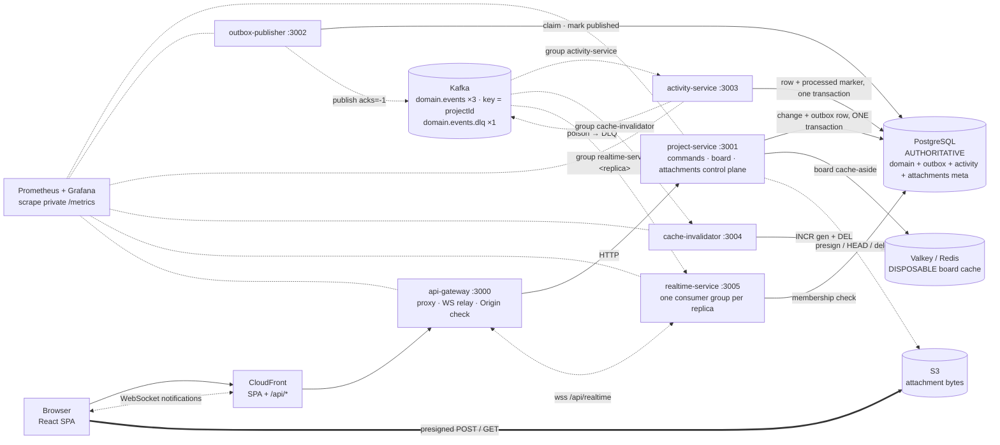
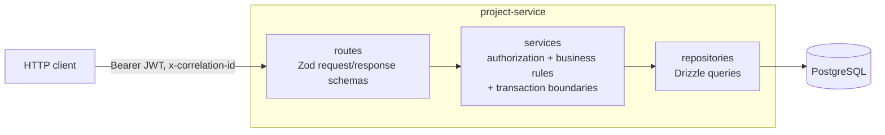
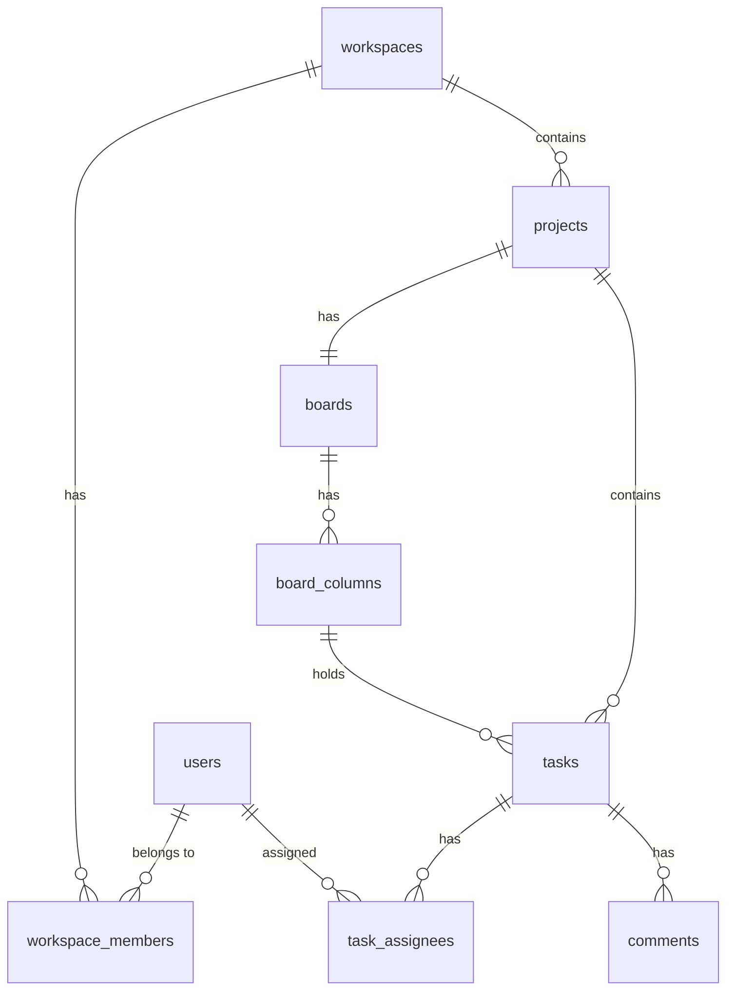
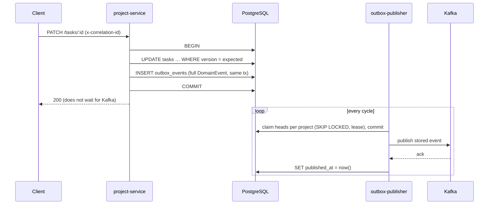

# Architecture

> Final state (Phase 10). A React frontend and an API Gateway in front of the Project Service
> (PostgreSQL, authoritative). Changes and their domain events commit together (transactional
> outbox); the Outbox Publisher delivers events to Kafka. Three consumers react: the Activity
> Service projects history (ADR-014), the Cache Invalidator keeps the shared board cache fresh
> (ADR-015), and the Realtime Service notifies connected browsers over WebSockets (ADR-016/017).
> Poison events go to a DLQ (ADR-019). Attachment bytes go browser ⇄ S3 directly (ADR-021).
> Every service exposes Prometheus metrics (ADR-020). Consistency and delivery guarantees:
> [consistency-and-delivery.md](consistency-and-delivery.md); failure behaviour:
> [failure-testing.md](failure-testing.md); measurements: [performance.md](performance.md).

## Topology

Legend: **solid** = synchronous request path · **dashed** = asynchronous (Kafka) ·
**dotted** = ephemeral realtime push · **thick** = object bytes (never through our services).
Cylinders are storage: PostgreSQL is authoritative; Redis is a disposable cache.



```
                         Client
                           │
                        Gateway
                           │
                     Project Service ──── board read: Redis (hit) ─── miss ──▶ PostgreSQL
                           │
                  PostgreSQL transaction
                   ┌───────┴────────┐
              domain state        outbox
                   └────COMMIT──────┘
                                    │
                            Outbox Publisher
                                    │
                                  Kafka
                        ┌───────────┴───────────┐
                 Activity Service        Cache Invalidator
                        │                       │
                 activity_events           Redis DEL
```

The request path ends at PostgreSQL. A task mutation commits its change **and** its event row
in one transaction, then responds. Kafka, the publisher, the Activity Service, the Cache
Invalidator and Redis cannot make a change fail. Redis can only make a board read slower (fall
back to PostgreSQL) or, briefly, older (the stale window in ADR-015).

The browser knows two origins: where the app is served from, and the gateway. It never learns
internal service addresses. `project-service` publishes no host port in Compose.

### Consistency at a glance

| Read                         | Source                       | Freshness after a change                                              |
| ---------------------------- | ---------------------------- | --------------------------------------------------------------------- |
| `GET /tasks/:id`             | PostgreSQL                   | immediate                                                             |
| `GET /projects/:id/board`    | Redis, else PostgreSQL       | normally sub-second (until invalidation); bounded by TTL (300 s)      |
| `GET /projects/:id/activity` | `activity_events` projection | normally seconds; later during an Activity Service outage, never lost |

## Deployment targets

The same images and configuration model run in two places:

- **Local**: Docker Compose (this document's topology diagram). Reproducible, used by the
  Playwright and Testcontainers suites.
- **AWS dev**: ECS Fargate behind CloudFront + ALB, RDS PostgreSQL, MSK with IAM auth, S3 for the
  SPA. See [aws-development.md](aws-development.md) and [ADR-012](adr/012-aws-development-runtime.md).

Only configuration differs (database connection parts + TLS CA, Kafka TLS/IAM, service discovery
name). No domain code knows which one it is running in.

## Source of truth

PostgreSQL holds all authoritative state ([ADR-001](adr/001-postgresql-source-of-truth.md)).
The browser cache, and later Redis and WebSocket messages, are all derived copies.

## API Gateway

A thin reverse proxy ([ADR-009](adr/009-thin-api-gateway.md)). It routes allowlisted `/api/<prefix>`
paths to the Project Service with the `/api` stripped. It owns CORS, security headers, the body
size limit, correlation IDs, upstream timeouts and safe 503s. It has no domain logic,
authorization or retries.

### Request ID vs correlation ID

| Header             | Scope                                                      | Who sets it                                                                                          |
| ------------------ | ---------------------------------------------------------- | ---------------------------------------------------------------------------------------------------- |
| `x-request-id`     | one hop (one service handling one HTTP request)            | each service; accepted from the caller if well-formed, never forwarded upstream                      |
| `x-correlation-id` | one logical operation across every hop (later: events too) | the browser (one per API call) or the gateway if missing/malformed; forwarded to every upstream call |

Inbound IDs are accepted only if they match `^[A-Za-z0-9._:-]{1,128}$`; anything else is
replaced. To trace a request, look up its `x-correlation-id` (returned in response headers) in
the logs. The gateway line and the Project Service line share it, and each has its own
`requestId`. This is verified with real processes in `tests/integration/gateway-chain.int.test.ts`.

### Failure behaviour through the gateway

| Situation                   | Browser receives                                                       | Bounded by                 |
| --------------------------- | ---------------------------------------------------------------------- | -------------------------- |
| Project Service unreachable | 503 `DEPENDENCY_UNAVAILABLE`, `details.reason: upstream_unreachable`   | connect timeout (2 s)      |
| Project Service too slow    | 503, `reason: upstream_timeout`, "may or may not have been applied"    | response timeout (15 s)    |
| PostgreSQL down             | the Project Service's own 503 `DEPENDENCY_UNAVAILABLE`, passed through | pool connect timeout (5 s) |
| Any upstream 4xx/5xx        | passed through unchanged (already in the public error shape)           | n/a                        |

No gateway retries, for any method. Raw socket errors and internal addresses appear only in
gateway logs (`upstream request failed`, with `reason` and `elapsedMs`).

## Frontend (`apps/web`)

React + TypeScript + Vite, React Router, TanStack Query. No global client state library.

- **One API boundary** (`src/lib/api/`). `ApiClient` owns the base URL, bearer header, a fresh
  `x-correlation-id` per call, JSON handling and runtime validation of every response against
  the shared Zod contracts in `@dpp/contracts`. It turns every failure into an `ApiError` with a
  `kind` (`validation`, `unauthenticated`, `forbidden`, `not_found`, `version_conflict`,
  `conflict`, `payload_too_large`, `unavailable`, `network`, `unexpected`). Components branch
  on `kind`, never on status codes, and never render raw response bodies.
- **Session** (`src/lib/auth/sessionStore.ts`). The token is held outside React and
  persisted in `localStorage` for local development. The UI never decodes the JWT: identity
  comes from `GET /me`, permissions from the server's responses. Any 401 ends the session,
  clears the query cache and routes to `/login?returnTo=…`, which says the session ended.
  (Production would use the identity provider's recommended storage, e.g. httpOnly cookies,
  not `localStorage`.)
- **Routes:** `/login`, `/workspaces`, `/workspaces/:workspaceId`, `/projects/:projectId`,
  `/projects/:projectId/tasks/:taskId` (task dialog over the board).

### Server-state strategy

Query keys are centralized in `src/lib/query/keys.ts` and are hierarchical:

| Key                                        | Data                      |
| ------------------------------------------ | ------------------------- |
| `['me']`                                   | current user              |
| `['workspaces']`                           | my workspaces             |
| `['workspace', id]`                        | one workspace (+ my role) |
| `['workspace', id, 'members'\|'projects']` | members / projects        |
| `['board', projectId]`                     | the board aggregate       |
| `['task', taskId]`                         | one task                  |
| `['task', taskId, 'comments']`             | its comments              |

Mutations are server-confirmed, with no optimistic updates. On success a mutation writes the
returned entity into its own key (for example `['task', id]`) and invalidates only the
aggregates it affected (for example `['board', projectId]`). Nothing invalidates everything.
The design assumes other writers exist: the board is always re-read from the server rather
than patched locally, so Phase 6 realtime notifications can trigger the same invalidations.

Reads retry at most twice, and only for `network`/`unavailable`. Mutations never retry. A
failed _refetch_ keeps the last good data on screen with a "showing the board as last loaded"
note and a retry button. Only a failed first load replaces the page.

### Concurrency-conflict UX

`TaskEditor` records the version the user's draft is based on. On `409 VERSION_CONFLICT`:

1. The save is reported as **not saved**, and nothing is resubmitted automatically.
2. `['task', id]` and `['board', projectId]` are invalidated, so the authoritative task is
   refetched.
3. The latest saved title/description and version are shown next to the user's draft, which is
   kept intact.
4. Saving is blocked until the user chooses **Discard my edits** (adopt the server version) or
   **Keep my edits and review** (rebase the draft on the version now on screen, then Save
   explicitly).

Board-level actions (moves, deletes) that conflict show a notice and refresh the board. No
realtime exists yet: a user sees another user's change after a refresh, a window refocus
(TanStack Query's default), navigation, or a conflict.

Tests: `src/features/tasks/TaskConflict.test.tsx` (stateful fake server) and
`tests/e2e/concurrency.spec.ts` (two real browsers, real stack). Both were mutation-checked:
injecting a silent retry, swallowing the conflict, skipping the refetch or overwriting the
draft each makes them fail.

## Project Service



The layers stay separate so later phases can slot in without rewriting handlers:

| Layer        | Responsibility                                                                 | Must not                                   |
| ------------ | ------------------------------------------------------------------------------ | ------------------------------------------ |
| routes       | HTTP shape: params/body/query validation, status codes, response serialization | contain SQL or authorization decisions     |
| services     | authorization, business rules, transaction boundaries, version checks          | know about HTTP                            |
| repositories | individual queries, accepting either the pool or an open transaction           | open transactions or make permission calls |

Services open the transaction and pass it (`DbExecutor`) to every repository and
authorization call. Checks and writes therefore see one consistent state, and the Phase 4
outbox insert can join the same transaction.

### Request path

1. `requestIdOptions` + `registerRequestContext` (`@dpp/observability`): accept or generate
   `x-request-id` and `x-correlation-id` (inbound values are validated against a safe pattern),
   bind them to the request logger, echo them in response headers.
2. `requireAuthentication` (`onRequest`): verifies the bearer JWT via the `AuthProvider`
   interface (`@dpp/auth`; `LocalJwtAuthProvider` checks HS256 signature, `exp`, `iss`, `aud`,
   and claim shape). This runs before body validation, so anonymous callers get 401, not 400.
3. Zod validation of params/query/body (`fastify-type-provider-zod`).
4. Service method: authorization (`domain/access.ts`) resolves the resource and the caller's
   membership in one query, then answers 404 if the resource is missing and 403 if the caller
   isn't a member or lacks the role.
5. Errors map to the public error model (`http/errors.ts`).
6. One structured `request completed` log line with `requestId`, `correlationId`, `userId`,
   the route template, status and duration.

### Authorization

Roles are per workspace: `OWNER > ADMIN > MEMBER` (`domain/roles.ts`).

| Operation                                        | Minimum role |
| ------------------------------------------------ | ------------ |
| read workspace, members, projects, boards, tasks | MEMBER       |
| create/edit/move/delete tasks, assign, comment   | MEMBER       |
| create projects, add members                     | ADMIN        |
| grant ADMIN                                      | OWNER        |

Privilege only flows downward: admins can add members but not admins, and nobody can grant
OWNER through the API.

### Error model

Every error response has the shape
`{ "error": { "code", "message", "details"?, "requestId" } }`. Raw driver errors and stack
traces are logged, never returned.

| Status | Code                     | When                                                        |
| ------ | ------------------------ | ----------------------------------------------------------- |
| 400    | `VALIDATION_FAILED`      | schema validation (details list the failing paths)          |
| 400    | `BAD_REQUEST`            | business-rule rejection (column not in project, bad anchor) |
| 401    | `UNAUTHENTICATED`        | missing/invalid token                                       |
| 401    | `TOKEN_EXPIRED`          | expired token                                               |
| 403    | `FORBIDDEN`              | not a member / insufficient role                            |
| 404    | `NOT_FOUND`              | resource or route missing                                   |
| 409    | `VERSION_CONFLICT`       | stale `expectedVersion` (details carry `currentVersion`)    |
| 409    | `CONFLICT`               | duplicate membership, dangling reference                    |
| 413    | `PAYLOAD_TOO_LARGE`      | body over 1 MiB                                             |
| 503    | `DEPENDENCY_UNAVAILABLE` | PostgreSQL unreachable                                      |
| 500    | `INTERNAL`               | anything unexpected                                         |

## Data model



Notes:

- UUID primary keys (`gen_random_uuid()`), `timestamptz` everywhere, written in UTC.
- `tasks.project_id` is denormalized from `column → board → project`. Authorization and
  (from Phase 3) the Kafka partition key are then a single lookup. Services guarantee that the
  column belongs to the same project on create and move.
- **Soft delete only on tasks** (`deleted_at`): activity history and late-arriving events can
  still refer to them. Nothing else is soft-deleted.
- **Ordering** uses a fractional `NUMERIC` `position`. A move rewrites only the moved row.
  Midpoints are computed as `(a + b) * 0.5`, which is exact for `NUMERIC`; `/ 2` rounds to a
  limited scale and would eventually collide. Two concurrent moves into the same gap can get
  equal positions; reads break ties by `id`, so order stays deterministic. No rebalancing job
  exists yet. Each insert into the same gap adds one decimal digit, which is harmless at
  realistic volumes (tested with 40 consecutive same-gap inserts).
- **The board read** (`GET /projects/:id/board`) runs in a `REPEATABLE READ, READ ONLY`
  transaction so its several queries observe one snapshot. This is the aggregate that Phase 7
  will cache.

## Concurrency

See [ADR-008](adr/008-optimistic-concurrency-control.md).

## Event path: transactional outbox

Decision record: [ADR-011](adr/011-transactional-outbox.md).



**Why not `await db.update(); await kafka.send()`?** If Kafka is down or the process dies
between those two lines, the change is committed and its event is lost for good. Sending first
is no better: the transaction can still roll back after consumers have seen the event.

**Atomicity boundary.** One PostgreSQL transaction per request contains the authorization
checks, the version-checked write and `insertOutboxEvent(tx, event)`. `insertOutboxEvent` accepts
only a transaction handle (by type), and the architecture guard fails on any other first argument.
Events are built from the row the write returned, so `aggregateVersion` is the committed
post-mutation version. The correlation ID is the request's. Every task version has exactly one
event: a no-op save writes nothing and returns 409 if stale.

| Mutation                                        | Event             | Task version                             |
| ----------------------------------------------- | ----------------- | ---------------------------------------- |
| `POST /tasks`                                   | `task.created`    | 1                                        |
| `PATCH /tasks/:id` (a change)                   | `task.updated`    | +1                                       |
| `POST /tasks/:id/move`                          | `task.moved`      | +1                                       |
| `DELETE /tasks/:id`                             | `task.deleted`    | +1 (soft delete)                         |
| `POST /tasks/:id/assignees` (new)               | `task.assigned`   | +1                                       |
| `DELETE /tasks/:id/assignees/:u` (was assigned) | `task.unassigned` | +1                                       |
| `POST /tasks/:id/comments`                      | `comment.created` | unchanged (comment aggregate, version 1) |
| no-op save / already (un)assigned / 4xx         | none              | unchanged                                |

**Publisher.** The claim → send → mark cycle, leases, head-of-line ordering per project,
backoff formula and failure windows are described in ADR-011.

| Setting                              | Default      | Meaning                                                |
| ------------------------------------ | ------------ | ------------------------------------------------------ |
| `OUTBOX_BATCH_SIZE`                  | 50           | events claimed per cycle (≤ 1 per project)             |
| `OUTBOX_POLL_INTERVAL_MS`            | 500          | sleep when idle; while work exists it re-polls at once |
| `OUTBOX_LEASE_MS`                    | 60000        | claim lease; must exceed the longest publish attempt   |
| `OUTBOX_BACKOFF_BASE_MS` / `_MAX_MS` | 1000 / 60000 | per-row and per-worker retry backoff (equal jitter)    |
| `OUTBOX_WORKER_ID`                   | hostname-pid | written to `claimed_by`                                |

Probes: `/health` (process alive), `/ready` (database answering **and** Kafka accepting
publishes), `/status` (backlog: pending, oldest pending age, failing). Publisher readiness never
affects the Project Service. Compose health-checks `/health` only, so a Kafka outage doesn't
restart a worker that will recover by itself.

**Guarantees, stated narrowly.**

- A committed change always has a durable event (tests: every mutation × three injected failure
  points, see below).
- Delivery is **at-least-once**. The ack-then-crash window republishes the same `eventId`;
  healthy workers never race on a row.
- Per project, publication follows outbox order, which for one task is its version order. There is
  no order across projects.
- Events of different tasks in one project follow the order in which their transactions
  became visible.

**Operations.** `scripts/outbox status | pending | failing | recent` reads the Compose
database. `scripts/outbox backlog --tasks N` creates events through the real API.
`npm run demo:kafka-outage` runs the outage demonstration against the stack.

## Kafka and domain events

Decision record: [ADR-010](adr/010-kafka-domain-event-transport.md).

### Local broker

| Setting         | Value                                                                                                                                            |
| --------------- | ------------------------------------------------------------------------------------------------------------------------------------------------ |
| Image / mode    | `apache/kafka:4.1.1`, single node, KRaft (combined broker + controller), no ZooKeeper                                                            |
| From containers | `kafka:9092` (listener `PLAINTEXT`)                                                                                                              |
| From the host   | `localhost:9094` (listener `EXTERNAL`). Kafka returns advertised addresses, so each network needs its own                                        |
| Persistence     | named volume `kafka-data` at `/var/lib/kafka/data`, fixed `CLUSTER_ID`. Topics and offsets survive restarts; `docker compose down -v` wipes them |
| Health check    | `kafka-broker-api-versions.sh` against the broker: a real protocol round-trip, not a process check                                               |
| Topics          | created only by the idempotent `kafka-init` job; broker auto-creation is off                                                                     |
| Heap            | 256–512 MB (sized for a laptop)                                                                                                                  |

| Topic               | Partitions | Retention | Purpose                                                |
| ------------------- | ---------- | --------- | ------------------------------------------------------ |
| `domain.events`     | 3          | 7 days    | every domain event, keyed by `projectId`               |
| `domain.events.dlq` | 1          | 30 days   | reserved for dead-lettered messages (routing: Phase 9) |

Nothing that serves traffic depends on Kafka in Phase 3: no app service has `depends_on: kafka`,
no request-path package imports it (`tests/architecture/request-path.test.ts`), and the full
browser flow works with the broker stopped (`tests/e2e/kafka-independence.spec.ts`).

### Event envelope

```ts
{
  eventId: uuid,            // unique per occurrence; the consumer idempotency key (ADR-013)
  eventType: 'task.created' | 'task.updated' | 'task.moved' | 'task.deleted'
           | 'task.assigned' | 'task.unassigned' | 'comment.created',
  aggregateType: 'task' | 'comment',
  aggregateId: uuid,        // task id (comment id for comment.created); must match the payload
  aggregateVersion: int,    // tasks.version AFTER this change (comments: always 1)
  occurredAt: string,       // ISO-8601 UTC with Z
  producer: string,         // e.g. "project-service"
  correlationId: string,    // the originating request's correlation ID, unchanged
  causationId?: string,     // set only when one event/action causes another
  schemaVersion: 1,         // version of this format, NOT of the aggregate
  payload: { projectId, actorId, ... }   // per type, below
}
```

| Event                               | Payload (besides `projectId`, `actorId`)                                       |
| ----------------------------------- | ------------------------------------------------------------------------------ |
| `task.created`                      | `taskId, columnId, title, position`                                            |
| `task.updated`                      | `taskId, title?: {previous, current}, descriptionChanged`; at least one change |
| `task.moved`                        | `taskId, title, fromColumnId, toColumnId, position` (same column = reorder)    |
| `task.deleted`                      | `taskId, title, columnId` (soft delete)                                        |
| `task.assigned` / `task.unassigned` | `taskId, title, assigneeId`                                                    |
| `comment.created`                   | `commentId, taskId, taskTitle, excerpt (≤280 chars), bodyLength`               |

Events are built only through `taskEvents.*` / `commentEvents.*` / `createDomainEvent`, which
fill `eventId`, `occurredAt`, `producer` and `schemaVersion` and validate the result. An
invalid event throws at construction, and the producer validates again before sending.

### Wire format

Value: UTF-8 JSON of the envelope. Key: `projectId`. Headers (for tooling; consumers trust
the body, not the headers): `event-id`, `event-type`, `schema-version`, `correlation-id`,
`content-type`. The message timestamp is `occurredAt`.

### Producer semantics (`DomainEventProducer`)

- `publish()` resolves only after a broker acknowledgement with `acks=-1`, returning `{topic,
partition, offset, key}`. Any failure rejects with `PublishError`, and nothing is logged as
  published.
- KafkaJS retries internally (4 retries, 250 ms to 2 s backoff). Observed: a publish with the
  broker down fails after about 4 s.
- `maxInFlightRequests: 1` keeps per-partition order across retries. No idempotent producer
  (experimental in KafkaJS), so retries can duplicate.
- `close()` stops accepting publishes (`ProducerClosedError`), waits a bounded time for
  in-flight sends, then disconnects with a bound.

### Consumer semantics (`DomainEventConsumer`)

- Explicit `groupId` and topics. New groups start from the beginning; existing groups resume
  at their committed offsets.
- Every message is decoded and validated. The handler receives the typed event plus
  `{topic, partition, offset, key, headers, consumerGroup}`.
- Offsets: KafkaJS auto-commit. Marked after the handler resolves, committed per batch.
  **At-least-once: duplicates are possible and expected.** Handlers with side effects wrap them
  in `createIdempotentHandler` (next section).
- `stop()` stops fetching, waits for the in-flight handler, commits and leaves the group. It is
  bounded (default 10 s). It takes about as long as the fetch long-poll: 1 s (`maxWaitTimeMs`;
  KafkaJS’s own default of 5 s made every stop and rolling deploy take ~5 s).

### Idempotent consumption (Phase 5)

Decision record: [ADR-013](adr/013-idempotent-consumers.md). A logical consumer (stable name,
shared by its replicas; also its consumer group) records `(consumer_name, event_id)` in
`processed_events` in the same transaction as its side effects. The INSERT is the claim:
`ON CONFLICT DO NOTHING` returns nothing for an event already processed, and a concurrent
duplicate waits on the first transaction's uncommitted key. The handler resolves only after
COMMIT, so the database commit always precedes the Kafka offset commit.

| Situation                            | Outcome                                                  |
| ------------------------------------ | -------------------------------------------------------- |
| Same event delivered twice           | second delivery → `duplicate`, side effect once          |
| DB committed, offset commit lost     | redelivery → `duplicate`, side effect once               |
| Crash or handler error before COMMIT | nothing persisted; redelivery → `processed`              |
| Two replicas, same event, same time  | one `processed`, one `duplicate` (unique key serializes) |
| Two logical consumers                | each `processed` once, two markers                       |
| Malformed message                    | skipped before the handler; no marker                    |

```ts
const handler = createIdempotentHandler({
  db,
  consumerName: 'activity-service',
  logger,
  handle: async (event, tx) => {
    /* write side effects with tx only */
  },
  onOutcome: (outcome) => {
    /* processed | duplicate | failed → metrics later */
  },
});
new DomainEventConsumer({ kafka, logger, groupId: 'activity-service', topics, handler });
```

### Malformed-message policy

Parsing classifies every failure; the checks run in this order:

| Reason                       | Example                                                                                  |
| ---------------------------- | ---------------------------------------------------------------------------------------- |
| `invalid_json`               | truncated bytes                                                                          |
| `invalid_envelope`           | missing/invalid `eventId`, non-UTC `occurredAt`, unsafe `correlationId`                  |
| `unsupported_schema_version` | `schemaVersion: 900` (checked before the type)                                           |
| `unknown_event_type`         | `task.teleported`                                                                        |
| `invalid_payload`            | a `task.created` payload under `task.moved`, a missing field, `aggregateId` ≠ payload id |

A malformed message is logged at `warn` with its coordinates and reason (never the raw
bytes), passed to `hooks.onInvalidMessage`, and, for consumers with a DLQ (activity-service),
dead-lettered with bounded raw bytes before its offset is committed (ADR-019). Consumers
without a DLQ skip it with the offset committed. Either way it cannot block or loop.

### Correlation

`requestId` identifies one hop; `correlationId` identifies the logical operation. Event
factories take the Project Service's correlation ID unchanged, and it survives Kafka
byte-for-byte (verified with a gateway-style UUID in `consumer.int.test.ts`). Producer and
consumer logs carry `eventId`, `eventType`, `correlationId`, `topic`, `partition`, `offset`,
`consumerGroup`. From Phase 4 the chain is HTTP request → outbox row → event → consumer logs.

### Observed broker outage and recovery

Measured on this development machine, which was heavily loaded (numbers vary):

| Step                                                | Observed                                                                    |
| --------------------------------------------------- | --------------------------------------------------------------------------- |
| publish while the broker is stopped                 | `PublishError` after 4.1–4.3 s                                              |
| broker `docker start` → serving metadata            | 12–59 s                                                                     |
| same producer object publishes after restart        | first attempt, under 150 ms                                                 |
| same consumer object receives that event            | about 30 s (KafkaJS restarts the crashed consumer, which rejoins its group) |
| producer close + consumer stop with the broker down | 6 ms – 5 s (bounded by configured timeouts)                                 |

No application-level reconnect code exists; recovery is KafkaJS's own.

### Tooling

`scripts/kafka <command>` against the Compose broker (host listener):

| Command                                                                                | Does                                            |
| -------------------------------------------------------------------------------------- | ----------------------------------------------- |
| `init-topics`                                                                          | create/verify topics (idempotent)               |
| `topics`                                                                               | partitions, leaders, low/high offsets           |
| `groups`                                                                               | consumer groups, committed offsets, lag         |
| `produce-sample [--type T] [--project ID] [--correlation-id C]`                        | publish a valid event via the factories         |
| `produce-malformed --kind invalid-json\|unknown-type\|bad-schema-version\|bad-payload` | demo the malformed policy                       |
| `consume [--group G] [--from-beginning]`                                               | probe consumer; Ctrl-C leaves the group cleanly |

Run it through `scripts/kafka` (which `exec`s node), not `npm run`: npm exits on Ctrl-C and
kills a consumer before it can leave its group (observed: the group kept a stale member until
its session timed out).

## Failure behaviour

Moved to [failure-testing.md](failure-testing.md) (the tested failure matrix with injection
method, observed behaviour and recovery for every dependency) and
[consistency-and-delivery.md](consistency-and-delivery.md) (what each guarantee is).
