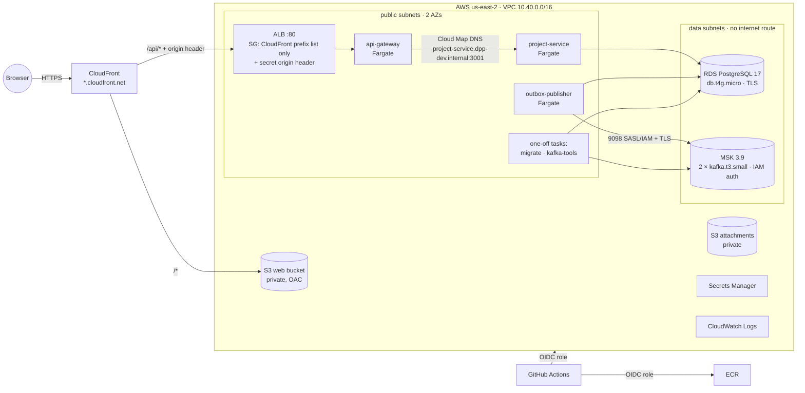

# AWS development environment

The `dev` environment runs the whole platform in AWS so Docker Desktop can stay closed. Everything
is created, deployed, inspected and destroyed from the terminal; the AWS Console is optional.
Decision record: [ADR-012](adr/012-aws-development-runtime.md).

| Where             | What                                                              |
| ----------------- | ----------------------------------------------------------------- |
| Your Mac          | source, editor, unit tests, `npm run aws:*` commands              |
| GitHub            | CI on every push/PR; image builds and deploys (manual, main only) |
| AWS (`us-east-2`) | network, PostgreSQL, Kafka, containers, web hosting, logs         |

## Architecture



Nothing in the data subnets can reach or be reached from the internet. Tasks sit in public
subnets with public IPs **only for outbound** calls to AWS APIs (ECR, Secrets Manager, CloudWatch,
SSM); their security groups admit no inbound traffic except from the load balancer (gateway) or the
gateway (project-service). The ALB itself only admits CloudFront, and only forwards requests
carrying a secret header that this distribution adds.

## Prerequisites

- AWS CLI v2, authenticated (`aws sts get-caller-identity` works). SSO profiles work: set
  `AWS_PROFILE`. No credentials are stored in the repository or in CI.
- Terraform ≥ 1.10 and the Session Manager plugin (`session-manager-plugin`). Both can live in
  `~/.local/bin`; the scripts add it to `PATH`.
- `gh` (GitHub CLI), logged in to the account that owns the repository.
- Node.js 24 for unit tests and the smoke test. **Docker is not needed.**

The only value you provide is the budget alert email, in the untracked file
`infrastructure/terraform/environments/dev/local.auto.tfvars`:

```hcl
budget_alert_email = "you@example.com"
```

## Rebuild everything in one command

`npm run aws:rebuild` recreates the environment from nothing (the counterpart of
`npm run aws:destroy`): state bucket → `terraform plan` → confirmation → apply → GitHub Actions
build and deploy of the current `main` commit (images, migrations, topics, rollout, smoke) →
drift check. About 45 minutes, most of it MSK creation. `-- --yes` skips the prompt. Nothing
needs the AWS console.

## First time

```bash
npm run aws:bootstrap        # Terraform state bucket (idempotent; survives aws:destroy)
npm run aws:plan             # review the plan (no NAT, private data stores, sizes)
npm run aws:apply            # ~25-40 min, mostly MSK; also sets the GitHub AWS_DEPLOY_ROLE_ARN variable
git push origin main
npm run aws:deploy           # remote build → ECR → web → migrate → topics → roll services → smoke
npm run aws:test             # smoke, correlation in logs, Kafka probe, security checks, independence
```

## Everyday commands

| Command                                                      | What it does                                                                                                 |
| ------------------------------------------------------------ | ------------------------------------------------------------------------------------------------------------ |
| `npm run aws:status`                                         | account/region, app URL, deployed SHA, ECS services, ALB targets, RDS, MSK, Redis, S3, recent deploys        |
| `npm run aws:deploy [-- --infra]`                            | deploy the pushed `main` commit (optionally Terraform first); fails loudly                                   |
| `npm run aws:logs -- <service> [--since 1h] [--filter text]` | tail/search CloudWatch logs (`api-gateway`, `project-service`, `outbox-publisher`, `migrate`, `kafka-tools`) |
| `npm run aws:smoke`                                          | the deployed chain end to end, including a stale edit → 409                                                  |
| `npm run aws:test`                                           | the full cloud verification suite                                                                            |
| `npm run aws:migrate`                                        | run migrations as a one-shot task in the VPC (also run on every deploy)                                      |
| `npm run aws:kafka:init`                                     | create/verify `domain.events` (3) and `domain.events.dlq` (1), replication 2                                 |
| `npm run aws:kafka:probe`                                    | produce + consume an event inside the VPC; verify schema, eventId, correlationId                             |
| `npm run aws:exec -- <service> [cmd]`                        | shell into a running container (ECS Exec over SSM; no SSH)                                                   |
| `npm run aws:db:tunnel`                                      | `localhost:15432` → RDS through a running task (SSM port forwarding)                                         |
| `npm run aws:security-check`                                 | network-boundary probes from your Mac + configuration checks                                                 |
| `npm run aws:audit`                                          | read-only audit of live AWS state (network, SGs, RDS, MSK, S3, ECR, IAM, logs, budget) + JSON inventory      |
| `npm run aws:cost-info`                                      | what is running and its current on-demand rate (AWS Pricing API)                                             |
| `npm run aws:rollout -- <sha>`                               | deploy (or roll back to) an already-built image SHA                                                          |
| `npm run aws:destroy`                                        | tear down the environment (confirmation required)                                                            |
| `npm run aws:destroy:all`                                    | …and the state bucket                                                                                        |

To trace one request: take the `x-correlation-id` response header (or the smoke test's
`correlationId=` line) and run `npm run aws:logs -- project-service --since 1h --filter <id>`.

## Deployment

`aws:deploy` requires a clean `main` that is pushed (the AWS role trusts only
`repo:The-RealOG@168302805/distributed-events-platform@1388724647:ref:refs/heads/main`, GitHub's immutable subject with owner and repository IDs). It starts the **Deploy to AWS
dev** workflow and watches it:

1. **images**: builds `project-service`, `api-gateway`, `outbox-publisher`, `kafka-tools` on the
   GitHub runner, pushes `<repo>:<git-sha>` (tags are immutable; existing SHAs are skipped).
2. **web**: builds the SPA with `VITE_API_BASE_URL=/api`, syncs it to the private bucket,
   invalidates `index.html`.
3. **rollout** (`scripts/aws/rollout.sh <sha>`): registers task-definition revisions pointing at
   the SHA → runs the migration task (stops on failure) → ensures Kafka topics → rolls the three
   services → waits for stability → records the SHA in SSM `/dpp-dev/image-tag` → smoke test.

Rollback: `npm run aws:rollout -- <previous-sha>` (images are kept; the 15 newest per repository).
A rollout whose new tasks never become healthy is rolled back automatically by the ECS deployment
circuit breaker.

## Database access

RDS has no public endpoint. `npm run aws:db:tunnel` forwards `localhost:15432` through a running
project-service task using SSM (the same channel as ECS Exec). The command prints nothing secret;
fetch the password yourself when you need it (see the comment at the top of
`scripts/aws/db-tunnel.sh`). Services connect as the least-privilege role `dpp_app`; only the
migration task uses the RDS-managed owner credentials.

## Configuration boundary

The application does not know it is in AWS. Differences are configuration only:

| Setting           | Local (Compose)             | AWS dev                                                                                                              |
| ----------------- | --------------------------- | -------------------------------------------------------------------------------------------------------------------- |
| Database          | `DATABASE_URL`              | `DB_HOST`/`DB_PORT`/`DB_NAME` + `DB_USER`/`DB_PASSWORD` injected from Secrets Manager, combined by `withDatabaseUrl` |
| Database TLS      | none                        | `DATABASE_TLS_CA_FILE=/app/certs/rds-global-bundle.pem` (verified TLS; RDS enforces it)                              |
| Kafka             | `KAFKA_BROKERS=kafka:9092`  | MSK IAM bootstrap brokers, `KAFKA_SSL=true`, `KAFKA_AUTH=aws-iam`, `AWS_REGION`                                      |
| JWT key           | env value                   | Secrets Manager (generated by Terraform)                                                                             |
| Service discovery | Compose DNS                 | Cloud Map: `project-service.dpp-dev.internal`                                                                        |
| Web → API         | `http://localhost:3000/api` | same origin: `/api` via CloudFront                                                                                   |

## Testing

| Command                          | Needs                    | Runs                                                          |
| -------------------------------- | ------------------------ | ------------------------------------------------------------- |
| `npm test` / `npm run test:unit` | nothing                  | all unit and component tests                                  |
| `npm run test:docker`            | Docker                   | integration tests with Testcontainers (also run in GitHub CI) |
| `npm run test:e2e`               | local Compose stack      | Playwright                                                    |
| `npm run test:aws`               | deployed dev environment | `aws:test`                                                    |

## Destroy and costs

`npm run aws:destroy` checks that the target is `dev`, shows the account and region, and asks you
to type `dpp-dev`. Then it destroys everything Terraform created and deletes the task-definition
revisions that deploys registered. By design nothing lingers:

- RDS is deleted **without a final snapshot** (and its automated backups with it).
- Buckets and ECR repositories are emptied first (`force_destroy`/`force_delete`).
- Secrets are deleted immediately (no recovery window).
- Log groups, the budget, the OIDC provider and all roles are removed.

What remains: the Terraform state bucket (a few KB; cents per month). `aws:destroy:all` removes it
too. Recreating the environment later is `aws:apply` + `aws:deploy` (MSK takes ~25-40 minutes).

The main cost drivers while it exists are the two MSK brokers, RDS, the ALB, the Fargate tasks
and their public IPv4 addresses; see `npm run aws:cost-info` for live rates. MSK cannot be paused,
so destroying between sessions is the way to stop the charge. A monthly AWS Budget
(`monthly_budget_usd`, default $50) emails at 50%, 80% and 100% of actual spend and at 100% of
forecast; AWS sends a subscription confirmation email first.

## Troubleshooting

- **`AWS CLI is not authenticated`**: `aws configure sso` (or refresh your session), retry.
- **Deploy workflow cannot assume the role**: run from `main`; check
  `gh variable list` shows `AWS_DEPLOY_ROLE_ARN` (set by `aws:apply`).
- **Service stuck / rolled back**: `npm run aws:status`, then `npm run aws:logs -- <service> --since 30m`.
- **Migration failed**: its output is printed by `aws:migrate`/the workflow; fix and redeploy.
- **`aws:exec`/`aws:db:tunnel` fail with `TargetNotConnected`**: the task must be RUNNING and was
  started after ECS Exec was enabled; `aws ecs update-service --force-new-deployment` restarts it.
